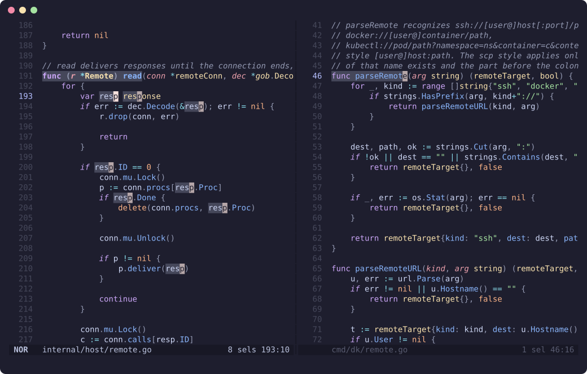
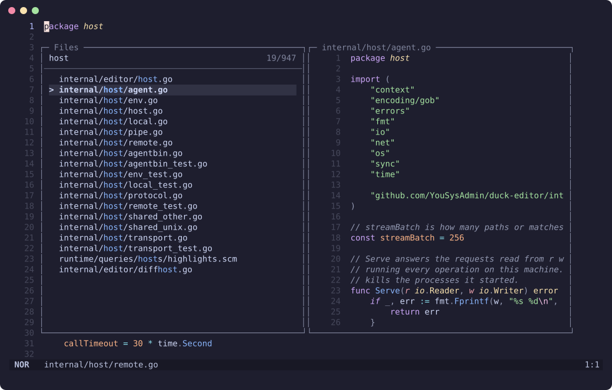

# Duck


Duck is a modal terminal editor.

Inspired by Helix.

The command is `dk`.



```sh
curl -fsSL https://raw.githubusercontent.com/YouSysAdmin/duck-editor/master/install.sh | sh
```

## Features
- **DevOps-oriented:** This is my personal editor, which I use in my DevOps work.
  Consequently, support for programming languages and other features are focused primarily on the requirements of this field.
  I do not add (and do not plan to add) obsolete or exotic languages.

- **Selections first.** Motions select, `d` `c` `y` and friends act on the
  selections. Split, filter, align and rotate many selections with a few keys.

- **Tree-sitter everywhere.** Highlighting, indentation, text objects
  (function, type, argument, comment, test) and syntax aware selection for
  well over a hundred languages. The grammars are built into the binary,
  nothing to download or compile.

- **Language servers.** Diagnostics, completion with snippets, hover,
  signature help, go to definition and references, rename, code actions,
  formatting and inlay hints. Several servers per language, with their
  features combined.

- **Pickers.** Files, global search, buffers, symbols, diagnostics, changed
  files and a file explorer, all with fuzzy filtering and a preview.



- **Git.** Changes in the gutter, jumps between hunks, blame of the cursor
  line.

- **Remote editing.** `dk host:path` edits on another machine over ssh,
  `dk docker://container/path` inside a container, `dk kubectl://pod/path`
  inside a pod. The editor and your config stay local, files, git and
  language servers run on the other side. Typing never waits for the network
  and a dropped connection comes back by itself.
- **Splits, registers, macros, jump list**, soft wrap, `.editorconfig`, the
  system clipboard (OSC 52 over ssh), undo history that survives restarts.

- **Plain YAML config** with strict keys: a typo is an error, not a silently
  ignored option. A project may add its own settings in `.duck/`.

## Documentation

The same pages as a site: https://yousysadmin.github.io/duck-editor/

|                                            |                                                             |
| ------------------------------------------ | ----------------------------------------------------------- |
| [Installation](docs/install.md)            | install script, building from source, updating              |
| [Editing](docs/editing.md)                 | selections, text objects, registers, macros, jumps, undo    |
| [Pickers and search](docs/pickers.md)      | pickers, filter syntax, previews, global search, prompts    |
| [Key bindings](docs/keys.md)               | every default key, by mode                                  |
| [Commands](docs/commands.md)               | the `:` command line                                        |
| [Ops tools](docs/ops.md)                   | shell, builds, checks, logs, Kubernetes, secrets, sudo      |
| [Files and sessions](docs/files.md)        | buffers, windows, saving, editorconfig, sessions, recovery  |
| [Troubleshooting](docs/troubleshooting.md) | servers, grammars, keys, clipboard, terminal                |
| [Configuration](docs/config.md)            | `config.yaml`, key bindings, project settings, every option |
| [Languages](docs/languages.md)             | `languages.yaml`, language servers, the supported languages |
| [Tools](docs/tools.md)                     | installing language servers, formatters and checkers        |
| [Grammars and queries](docs/queries.md)    | the runtime directory, building grammars, query captures    |
| [Themes](docs/themes.md)                   | theme files and scopes                                      |
| [Remote editing](docs/remote.md)           | ssh, containers, pods                                       |

Inside the editor `:help` opens a short overview, `space ?` lists every
command and pending keys show their menu.

## Quick start

| Keys                     | Action                                                       |
| ------------------------ | ------------------------------------------------------------ |
| `i` `a`                  | insert before / after the selection, `esc` returns           |
| `w` `b` `e`              | select to the next word start, previous word start, word end |
| `x`                      | select the line, again for the next one                      |
| `d` `c` `y` `p`          | delete, change, yank, paste                                  |
| `s`                      | select regex matches inside the selections                   |
| `C`                      | add a cursor on the next line                                |
| `space f` `space /`      | find a file, search the workspace                            |
| `gd` `space k` `space r` | go to definition, show docs, rename                          |
| `:w` `:q`                | write, quit                                                  |

## Command line

```sh
dk main.go util.go           # several files, the first one shown
dk main.go:42:7              # at a line and column, as compilers print them
kubectl get pod -o yaml | dk -l yaml -   # read stdin into a buffer
dk .                         # browse a directory
dk host:/etc/nginx           # edit on another machine, see docs/remote.md
dk @worker                   # a workspace of ~/.config/duck/workspaces.yaml
dk k8s://secrets/app?ns=prod  # a Kubernetes object, secrets decoded, see docs/ops.md
dk update                    # install the latest release
dk -w                        # pick a workspace or an ssh host
```

## Building

Duck is written in Go and built with [Task](https://taskfile.dev):

```sh
task all       # bin/dk and the grammars
task check     # format, vet, lint, tests
task install   # a self contained dk in ~/.local/bin
```

See [Installation](docs/install.md) for the details.
